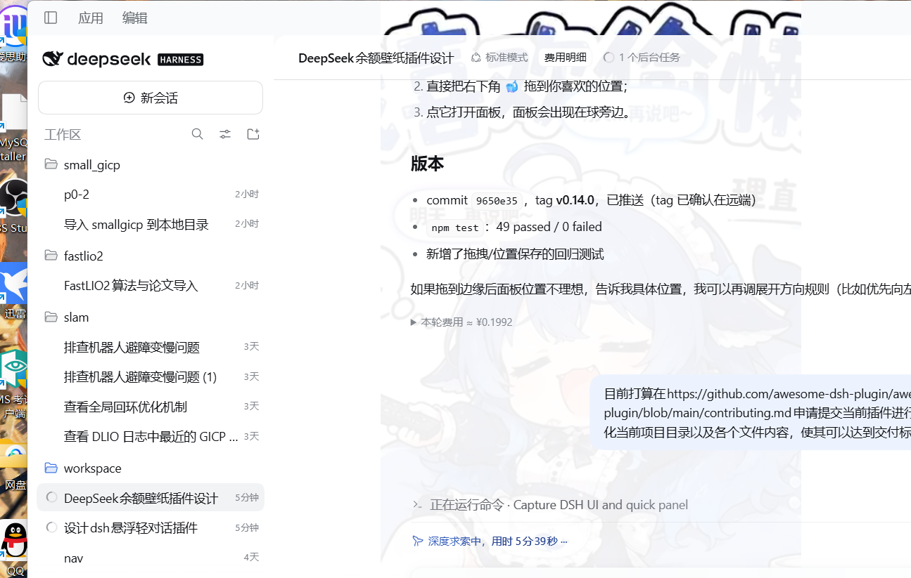
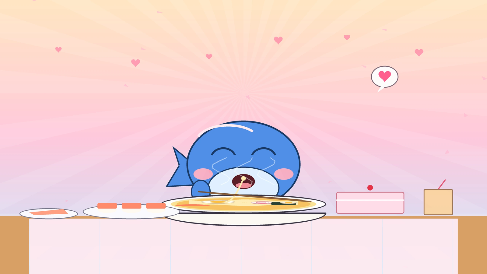

# dsh-spend-wallpaper · Balance wallpaper

[](https://github.com/sleeping112/dsh-spend-wallpaper/actions/workflows/ci.yml)
[](LICENSE)
[](https://github.com/deepseek-ai/deepseek-harness)

A DeepSeek Harness bundle that paints the DSH Web UI with a wallpaper chosen
from the DeepSeek balance spent during the **last rolling hour**. It ships a
five-tier chibi scene set, lets every tier use its own uploaded image or video,
and exposes a draggable whale button for a quick settings panel.

The same package also contains a terminal CLI (`status` / `render`).

## Install

```sh
# Desktop app profile (default desktop installation)
dsh plugin --profile desktop add github:sleeping112/dsh-spend-wallpaper

# Web profile
dsh plugin --profile web add github:sleeping112/dsh-spend-wallpaper
```

Restart DSH (or let HMR finish), then look for the 🐋 button in the bottom-right
corner of the window. The plugin appears under **Settings → Plugins** as
**Balance wallpaper / 余额壁纸**.

Local development install:

```sh
dsh plugin --profile desktop add link:/absolute/path/to/dsh-spend-wallpaper
```

## How it works

1. The host samples a balance source and keeps the values in a rolling window.
2. The hourly spend is `balance(now) − balance(now − 60 min)`; it is mapped to a
   tier with hysteresis and a minimum dwell time so the scene does not flicker
   at a boundary.
3. The client polls the host snapshot and renders the selected scene as a
   full-bleed fixed background. Panels, the chat composer, file-edit/code boxes
   and the document preview use semi-transparent theme tokens so the wallpaper
   stays visible; `surfaceOpacity`, `scrim` and `dim` tune readability.

Data sources, in `auto` order:

| Order | Source | When it works |
|---|---|---|
| 1 | `dsh-cost-meter` local usage estimate | When `dsh-cost-meter` is installed; works for subscription or zero-wallet accounts |
| 2 | Signed-in desktop account wallet | When DSH is signed in |
| 3 | `https://api.deepseek.com/user/balance` | When `DEEPSEEK_API_KEY` is available |
| — | `manual` | Fixed value for testing |

Only source 3 performs a network request, and only to the official API origin.

## Features

- **Full-bleed wallpaper** with translucent DSH surfaces (shell panels, chat
  composer, file-edit boxes, code blocks, document preview).
- **Rolling 1-hour spend**, not "spent today": a recharge or bonus reversal is
  treated as zero spend.
- **Configurable tiers**: 2–8 tiers, every threshold editable from the panel or
  `POST /config`; default thresholds are `0 / 0.05 / 0.30 / 1.50 / 6.00 ¥/h`.
- **Per-tier scenes**: the built-in five scenes can be replaced independently by
  uploading a PNG/JPEG/WebP/GIF/AVIF image or a WebM/MP4/MOV video.
- **Display settings per tier**: cover / contain / stretch, focal point X/Y
  (with top/center/bottom presets) and 100–300% zoom, applied to images and
  videos.
- **Per-tier scene names** editable from the panel; tier labels are saved.
- **Static/dynamic media**: `auto`, `static`, `dynamic`; honors
  `prefers-reduced-motion` and pauses videos while the window is hidden.
- **Draggable quick panel**: the 🐋 button can be moved anywhere; the position is
  remembered and the panel opens beside it.
- **Preview, lock, refresh, reset**: preview any tier for 15 seconds, lock a tier,
  refresh the source, or clear all presentation overrides.
- **Terminal surface**: `dsh-spend-wallpaper status` and `render` work from a
  terminal without the GUI.
- **Persistence**: samples, tier and scene overrides live in
  `$DSH_HOME/storages/spend-wallpaper/state.json`; uploaded media lives under
  `$DSH_HOME/storages/spend-wallpaper/scenes/`.

## Screenshots





Screenshots are declared in [screenshots.json](screenshots.json). The first is a
capture of the desktop UI; the second is the built-in tier-0 scene.

## Quick panel

Open the panel with the 🐋 button (or `Enter`/`Space` after focusing it):

- **当前场景画面**: when the active tier is a custom scene, fit/focal/zoom
  controls are shown immediately;
- **档位与阈值**: `−`/`+` changes the tier count, each threshold is a number
  field;
- **每档场景**: editable name, **上传**, **清除** and **调整画面** per tier;
- **外观**: panel opacity, wallpaper scrim, extra dim, blur;
- **动画**, **采样间隔**, **统计窗口**, **防抖**;
- **预览档位**, **锁定**, **刷新数据**, **关闭壁纸**, **恢复默认**.

Changes apply immediately and persist. The panel title carries the package
version, which makes it easy to tell a stale client bundle from a fresh one.

## Scenes and uploads

Built-in scenes live in `lib/assets/scenes/` and are copied on startup to:

```text
$DSH_HOME/storages/spend-wallpaper/scenes/
├─ builtin-0.webp / builtin-0.webm
├─ custom-0.png
└─ ...
```

Uploads accept images (`png`, `jpg`, `jpeg`, `webp`, `gif`, `avif`) and videos
(`webm`, `mp4`, `mov`, `m4v`). See [docs/scenes.md](docs/scenes.md) for the
display settings, the HTTP routes and the storage layout.

## Configuration

All fields are volatile Cordis `Config` fields. Most are also available from the
panel. Advanced users can patch the profile:

```yaml
- id: spend-wallpaper
  config:
    source: auto
    windowMinutes: 60
    sampleSeconds: 180
    thresholds: ["0", "0.05", "0.30", "1.50", "6.00"]
    media: auto
    scrim: 0.10
    dim: 0.03
```

| Field | Default | Meaning |
|---|---|---|
| `enabled` | `true` | Master switch |
| `source` | `auto` | `auto` / `cost-meter` / `account` / `api` / `manual` |
| `currency` | `CNY` | Display currency and threshold unit |
| `apiBase` | `https://api.deepseek.com` | Official origin only |
| `apiKeyEnv` | `DEEPSEEK_API_KEY` | Resolved through `ctx.credentials` or the environment |
| `windowMinutes` | `60` | Rolling window, 5–180 |
| `sampleSeconds` | `180` | Sampling interval, 60–600 |
| `media` | `auto` | `auto` / `static` / `dynamic` |
| `scrim` / `dim` / `blur` | `.10` / `.03` / `0` | Readability and atmosphere |
| `surfaceOpacity` | `.45` | Shell/inner-surface opacity (lower = more wallpaper) |
| `transitionMs` | `600` | Cross-fade duration |
| `hysteresis` | `.25` | Fraction of a threshold that must be crossed |
| `minDwellSeconds` | `600` | Minimum time in a tier |
| `thresholds` | `["0","0.05","0.30","1.50","6.00"]` | 2–8 ascending decimal strings, first is 0 |
| `manualSpend` | `"0"` | Fixed value for `source: manual` |
| `lockedTier` | `""` | Tier id/index to pin, empty = auto |

## HTTP routes

All routes are under `/plugins/dsh-spend-wallpaper/` and require a
DSH-authenticated browser or API session on this listener
(`ctx.connection.requestRejection`), on top of a same-origin fence. The host
binds to loopback by default.

| Method and path | Purpose |
|---|---|
| `GET .../state` | Current snapshot (`no-store`) |
| `GET .../scenes/<tier>?kind=image\|video` | Current scene file (built-in or uploaded; supports Range) |
| `POST .../scenes/<tier>` | Upload an image/video as raw body + Content-Type |
| `POST .../scenes/<tier>/reset` | Remove the uploaded scene and return to the built-in one |
| `POST .../refresh` | Sample immediately (10 s throttle) |
| `POST .../config` | Thresholds, media, opacity, sampling and other presentation overrides; `{reset:true}` clears overrides |

## Terminal

```sh
node bin/dsh-spend-wallpaper.mjs status
node bin/dsh-spend-wallpaper.mjs render
node bin/dsh-spend-wallpaper.mjs render --tier 4 --once
```

The CLI only reads the persisted snapshot; it does not need the GUI to be open.
See [docs/terminal.md](docs/terminal.md).

## Development

```sh
npm test                       # host + client + assets + terminal tests
node scripts/build-client.mjs  # validate the client bundle wrapper
npm run demo                   # render one ANSI frame
```

The client is a single self-contained `lib/client.js` Module Loader bundle; host
code is plain ESM. There is no compile step for the plugin itself. The built-in
artwork is generated by `scripts/gen-anime-assets.py` (Pillow + numpy + ffmpeg).

Project layout:

```text
bin/                  terminal CLI entry
lib/                  host modules, client bundle, scenes, terminal renderer
locale/               Plugin Manager metadata (en/zh)
assets/               icon and README screenshots
test/                 node --test suites
docs/                 quickstart, scenes, terminal, design
scripts/              build-client.mjs, gen-anime-assets.py
cordis.patch.yml      bundle patch (one host row)
```

## Known limitations

- The rolling window is **account-wide**: usage from another device signed into
  the same account is included.
- Balance APIs have minute-level billing delay; the value is approximate.
- `cost-meter` is a local estimate based on `dsh-cost-meter`'s counter and can
  differ from the official bill by a small amount.
- Native window-control transparency depends on Electron/Windows support; the
  in-app titlebar strip and the wallpaper are handled by the client.
- This is a DSH Web UI background, not a Windows desktop wallpaper.
- The terminal `render` command draws an ANSI approximation, not terminal
  emulator artwork.

## Security

The API key stays in the host process and is never included in snapshots or the
browser bundle. See [SECURITY.md](SECURITY.md) for the full boundary.

## License

Plugin code: [MIT](LICENSE). Built-in procedurally generated artwork:
[CC0-1.0](LICENSE-ASSETS).
